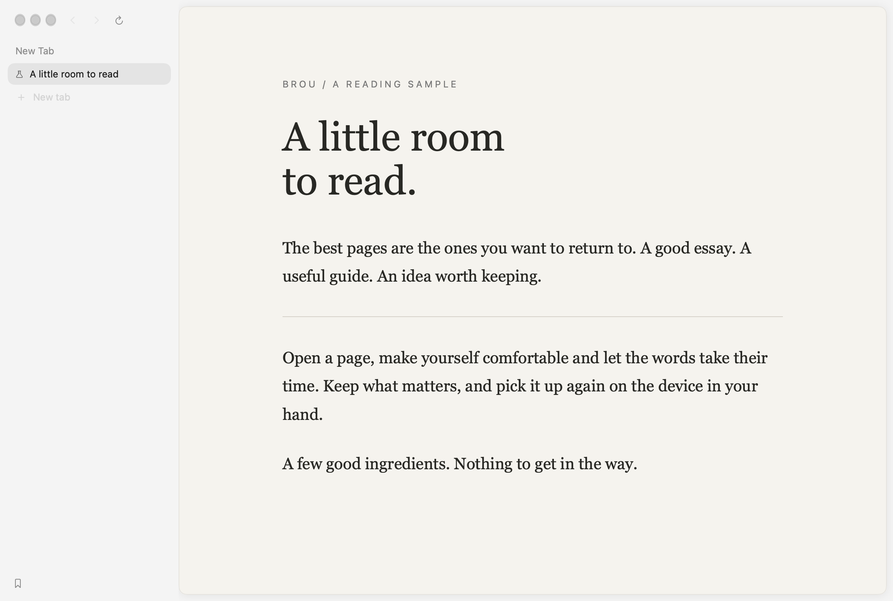

<div align="center">
  
  <h1>Brou</h1>
  <p>A little room to read.</p>
  <p>A lightweight WebKit browser for Mac, with an iPhone companion.</p>
  <p><a href="#try-brou">Build</a> · <a href="Docs/SYNC.md">Continuity</a> · <a href="Docs/PRIVACY.md">Privacy</a> · <a href="CONTRIBUTING.md">Contribute</a></p>
</div>

Brou brings comfortable reading, a quiet interface and your saved web to Mac and iPhone. Its name means **broth** in Catalan: a few good ingredients, kept simple.

Maintained by [Victor Correal](https://github.com/victorcorreal). Based on [Search by Office Commun](https://github.com/driceroland/Search), with its history and MIT notices preserved. The [iPhone and iPad companion](https://github.com/victorcorreal/search-ios) is maintained alongside this app.



*Actual app rendering with a synthetic local page and disposable data.*

## Made for

- **Reading without clutter.** Dark Pages and text-only reading, alongside the reader inherited from Search.
- **Keeping useful pages close.** A minimal start page with bookmarks one click away. Spaces, tabs and bookmark folders on Mac.
- **Continuing on iPhone.** CloudKit bookmarks and a shared iCloud Keychain group for Brou credentials. Suggestions stay within the current host, so CMS, development and public-site accounts stay separate.

Brou retains Search's native WebKit foundation, content blocker and Mac extension support. It adds its own continuity, reading refinements, password scoping and maintenance fixes. See [Brou 1.1.0](Docs/RELEASE_1.1.0.md) for the changes and [upstream integration](Docs/UPSTREAM_INTEGRATION.md) for attribution.

## Try Brou

This first public version is a **source preview**. There is no public notarized Mac download or automatic updater yet. You can build and use the Mac app locally without our Apple account:

```sh
git clone https://github.com/victorcorreal/search.git
cd search
./build.sh release
open build/Brou.app
```

Requires macOS 14 or later and full Xcode with a Swift 6 toolchain; the current source is checked with Xcode 27. Web extensions require macOS 15.4 or later. The build uses the checked-in icon and has no third-party Swift package dependencies. Without a signing certificate it uses ad-hoc signing for local use. A clean unsigned build has no shared iCloud capabilities.

[Build and Apple signing guide](Docs/BUILDING.md) · [iPhone source](https://github.com/victorcorreal/search-ios) · [Verification results and limits](Docs/VERIFICATION.md)

## Continuity, with clear boundaries

| Shared by the paired, correctly signed apps | Kept on each device |
| --- | --- |
| Bookmarks and bookmark folders via CloudKit | Open tabs, session and history |
| Brou credentials via iCloud Keychain | Cookies and website logins |

Both devices must use the same iCloud account and compatible signing identities. The current maintainer builds use **CloudKit Development**, fetching on launch, foreground activation and every five minutes. They are not a general iCloud service for unsigned builds. Passwords belong to Brou's own access group; they are separate from Apple's Passwords app. Read [how sync works](Docs/SYNC.md) before configuring your own Apple team.

Cold launch selects an empty start tab while preserving previous pages. Returning to the running app keeps the current page. New-tab requests reuse the existing empty start tab; an extension that owns the new-tab page keeps its own behavior.

## Privacy and updates

Brou adds no usage analytics or maintainer telemetry. Websites and the selected search engine still make network requests; the content blocker is not a promise of anonymity. iCloud is optional in a properly provisioned build. The inherited AI add-on is disabled. See the [privacy and network notes](Docs/PRIVACY.md).

Brou does not check or install Office Commun updates. Its inherited updater and publication scripts are disabled for normal use. Source publication is separate from Developer ID signing, notarization and a future Brou update channel. Never install a maintainer development profile from an issue or share your signing keys.

## Help shape it

[Report a bug](https://github.com/victorcorreal/search/issues/new/choose) with reproducible steps and synthetic examples. No browsing history, saved passwords or Apple account identifiers are needed. For security reports, use [private reporting](SECURITY.md).

```sh
python3 Tests/run-ci-tests.py
Tests/AddressRegression/run.sh
node Tests/popup_gesture_script.js
```

The Swift runner isolates all ten WebKit download journeys in separate processes. [CONTRIBUTING.md](CONTRIBUTING.md) explains additional probes, test isolation and upstream maintenance.

Brou is young. External adoption is not yet established. Feedback and public issues are the current evidence of use; upstream Search's stars and users belong to Search.

## License and origin

[MIT](LICENSE). Copyright © 2026 Office Commun and Victor Correal. This is an independently maintained variant, not an Office Commun release. Original authors and commit history remain intact. `CHANGELOG.md` and `ROADMAP.md` retain upstream history; Brou's changes are in [NOTES.md](NOTES.md). The internal target `Search` and compatibility identifiers remain to preserve data and make upstream maintenance practical. [Brand assets and provenance](Brand/README.md).
